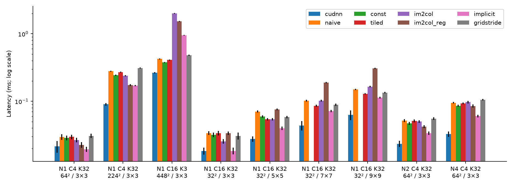
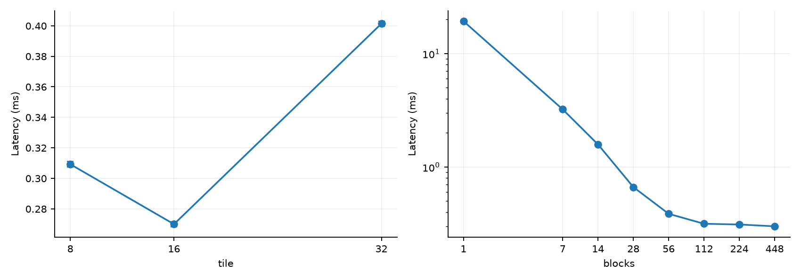
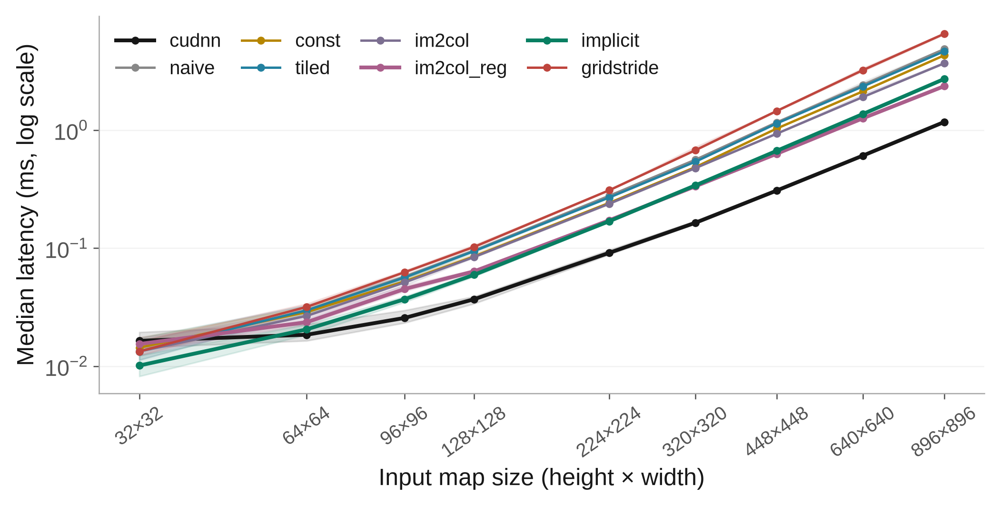
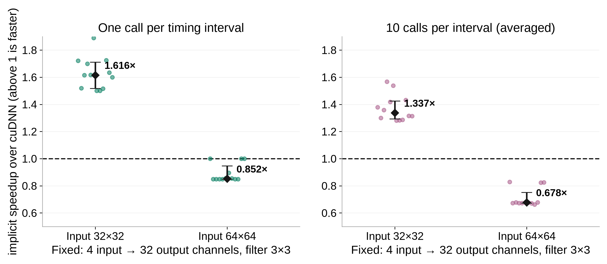
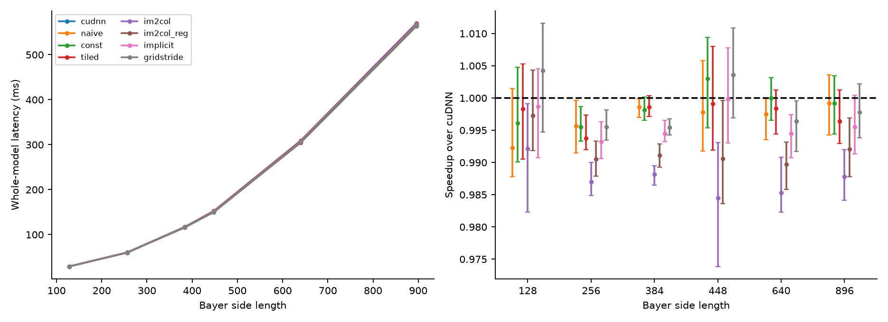
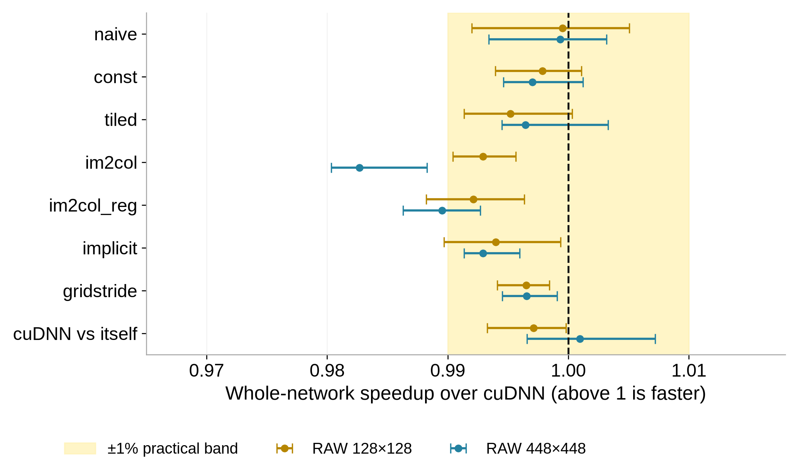
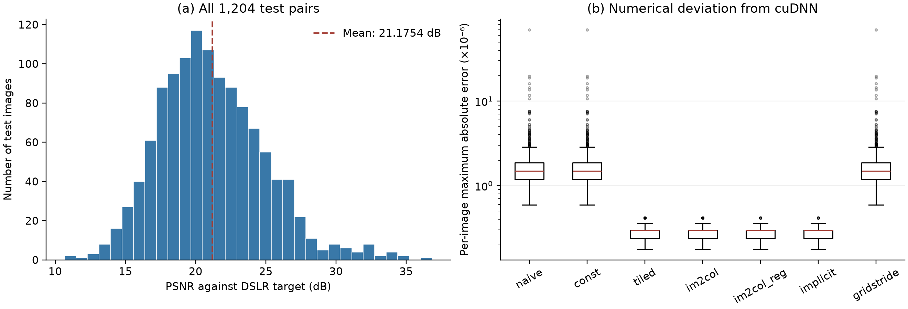
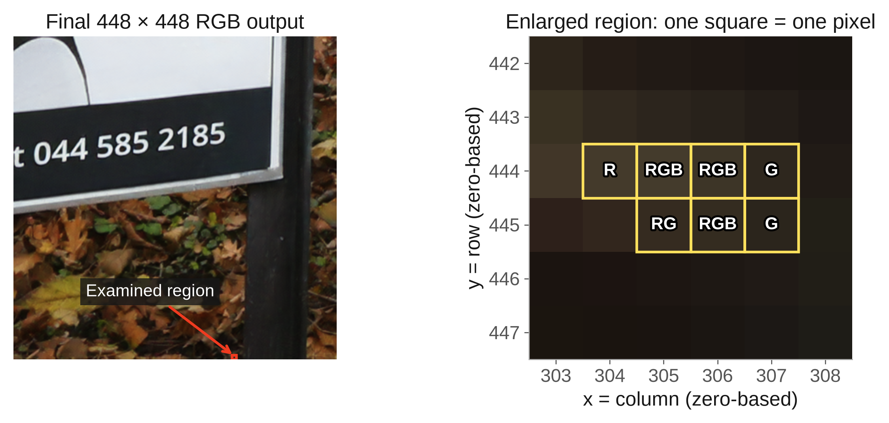

# CUDA Convolution Variants for RAW-to-sRGB Reconstruction

## Abstract

We implement seven CUDA convolution variants to study how memory reuse and thread scheduling affect FP32 inference. Evaluation combines nine heterogeneous workloads, a nine-size fixed-channel sweep, and twelve fresh-process repetitions of selected comparisons. At a 32×32 input, our implicit path achieves a median 1.616× speedup over the tested PyTorch/cuDNN convolution-with-bias path; a GPU trace shows that our implementation fuses a separate bias-add pass. Register blocking, tile selection, and grid sizing also yield repeatable, workload-specific gains. These operator gains do not translate into demonstrated PyNET acceleration: none of fourteen method–size comparisons supports a network speedup after multiple-comparison correction. All eight configurations process the complete 1,204-pair RAW-to-sRGB test set. Aggregate reconstruction quality is preserved, although three direct variants exceed a strict elementwise tolerance on the same image. Controlled interventions trace this exception to FP32 bias ordering and downstream normalization [10]. Our contribution is the CUDA implementation and experimental analysis; the PyNET architecture and pretrained weights are reused [1].

## 1. Introduction

A camera sensor records RAW measurements, whereas a display requires a color image such as sRGB. A neural image signal processor (ISP) learns this conversion from paired RAW and reference images. PyNET [1] is a convolutional neural ISP that processes features at several spatial scales to reconstruct a full-resolution color image.

Convolution is central to this computation. However, two implementations of the same convolution can have different costs: one may repeatedly read pixels from global memory, while another reuses them in shared memory or registers. Matrix-based implementations introduce another choice—whether to store all image windows in a temporary matrix or construct them as needed. Libraries such as cuDNN [2] optimize these choices for a wide range of workloads. Hand-written implementations help us examine the tradeoffs directly.

This project asks two questions. First, how do memory reuse and thread scheduling affect convolution performance across different tensor shapes? Second, how much of that difference remains visible in a complete RAW-to-sRGB network? To answer them, we implement seven convolution paths, connect each to the same two layers of pretrained PyNET, and measure both execution time and output accuracy. The network architecture and weights are from prior work [1].

## 2. Convolution Implementations

All seven paths compute the same FP32 convolution with bias. Mathematically, each output is the sum of input pixels multiplied by their corresponding filter weights plus a bias term; the FP32 order of bias addition differs across implementations (Section 6.2). Inputs use N×C×H×W layout; the implementations support batch processing, stride, and zero padding. Out-of-bounds input samples contribute zero.

**Table 1.** Seven implementation variants and references for their underlying techniques. These are established computation and optimization strategies; the variant names identify the implementations evaluated in this study.

| Variant | Implementation |
|---|---|
| naive [3] | One thread per output; direct global-memory accumulation |
| const [3] | Direct convolution with constant-memory weights |
| tiled [3] | Cooperative shared-memory input tiles and halos |
| im2col [2, 4] | Explicit lowering and shared-memory tiled GEMM |
| im2col_reg [2, 4, 9] | Explicit lowering and register-blocked GEMM |
| implicit [4] | GEMM-style tiles gathered directly from input |
| gridstride [8] | Direct convolution with a fixed grid and grid-stride loops |

The direct methods assign output pixels to threads. `gridstride` uses the grid-stride work assignment described by Harris [8]. `const` moves filter weights into constant memory, allowing threads that read the same weight to share a broadcast. `tiled` instead stages an input region in shared memory so neighboring outputs can reuse pixels. These choices follow the CUDA memory hierarchy [3].

The matrix-based methods reorganize convolution as matrix multiplication. `im2col` explicitly stores the image windows in a temporary matrix; `im2col_reg` additionally accumulates several outputs in each thread's registers, following the thread-level tiling principle described in [9]. `implicit` constructs the required windows while loading matrix tiles, avoiding the temporary matrix. The distinction between explicit and implicit lowering is described in the CUTLASS convolution documentation [4]. Our implementations use hand-written kernels and do not call CUTLASS, cuBLAS, or cuDNN.

For application evaluation, we use the pretrained PyTorch implementation of PyNET [1], a CNN-based neural ISP. It is an alternative implementation of the original paper; its reported scores and our evaluation protocol are distinguished in Section 6.1. We replace its input 4→32 and output 16→3 convolutions, both with 3×3 filters. Their weights fit the constant-memory limit, so all seven methods can run at the same locations. The remaining convolutions, reflection padding, normalization, activations, and upsampling retain the official implementation. The two selected layers account for 0.042% of network convolution multiply–accumulate operations (MACs).

## 3. Experimental Setup

### 3.1. Workloads and Data

The operator study uses nine workloads that vary input size, channel count, filter size, and batch size. We also vary the shared-memory tile size and the number of blocks launched by `gridstride` to examine scheduling choices on a fixed GPU.

The application study uses the Zurich RAW-to-RGB dataset introduced with PyNET [1]. Network timing uses Bayer-aligned crops with side lengths of 128, 256, 384, 448, 640, and 896 pixels from one genuine sensor image. Cropping preserves the Bayer pattern; no image resizing is applied. The RAW mosaic is packed into four channels and normalized using the official preprocessing.

Quality evaluation uses all 1,204 paired RAW/DSLR test patches at their native 448×448 size. The baseline and all seven custom configurations independently process every patch, giving 9,632 reconstructions. Quality scores average per-image metrics over the complete test set. The six-size experiment measures performance separately; larger sensor crops do not have matched DSLR targets.

### 3.2. Timing and Correctness

All experiments use an NVIDIA GeForce RTX 3060, FP32 arithmetic, and disabled TF32. Performance measurements enable cuDNN autotuning; full-test quality evaluation instead uses deterministic cuDNN with autotuning disabled and batch size one. The original nine-workload and six-RAW-size experiments use five warm-ups and 60 timings per setting. The separate nine-size operator sweep uses ten warm-ups and 120 timings. The repeated-process protocol below is a further experiment. For operator and whole-network comparisons, method order is randomly permuted in every repetition. Tile and grid configurations are measured sequentially, with repeated timing at each configuration.

CUDA events measure the GPU call interval; synchronized wall time is recorded separately. Event intervals can include GPU idle gaps between host dispatches, so these are invocation-level measurements rather than isolated kernel instruction timings. Inputs and weights are already on the GPU. Timing includes output allocation, temporary lowering buffers, and the per-call weight upload for `const`. It excludes compilation, model loading, image decoding, host/device transfers, and metric computation. Constant memory holds at most 16,384 FP32 weights; larger filters are marked N/A.

The binding passes 54 checks against float64 convolution, covering tensor shapes, batches, stride, padding, tile sizes, grid sizes, and supported CUDA streams. One constant-memory capacity case is explicitly rejected. We also compare every custom network output with the cuDNN reference at each timing input size and every native test patch. A comparison passes when every RGB channel value satisfies |output − reference| ≤ 2×10⁻⁵ + 10⁻⁴|reference|. We record exceptions rather than discarding them.

Original plots retain their single-session medians and descriptive intervals; those intervals do not establish a repeatable advantage. The follow-up uses twelve fresh Python processes on the same GPU, identical seeded tensors and RAW crops, and randomized case and method order. Each process uses 25 warm-ups and 200 timings per operator, ten warm-ups and 100 timings per tile/grid setting, and five warm-ups and 20 timings per network configuration. A second label invokes the exact same cuDNN callable as a timing-variation control. At 32×32 and 64×64, an additional sensitivity test averages ten full invocations per interval over 100 intervals.

The inferential unit is a fresh-process median, rather than an individual call. Reported speedup is the median of twelve paired process-time ratios; pointwise 95% intervals use 20,000 paired process-bootstrap resamples [11]. Selected claims use an exact sign-flip test of mean log speedup, assuming symmetric paired effects, with Holm correction [12] within fourteen network comparisons and, separately, four selected operator comparisons. Tile/grid intervals are descriptive. The ±1% network band is a practical reference, not an equivalence test. Processes run consecutively with unlocked GPU clocks; these intervals do not establish variation across days or devices.

The baseline is specifically PyTorch `F.conv2d` with bias backed by cuDNN, with FP32 and TF32 disabled. We compare complete invocation paths, including their allocation and dispatch costs; we do not claim that a custom arithmetic kernel exceeds every cuDNN algorithm or fused API.

### 3.3. Quality Measures

We evaluate every method against the DSLR target using PSNR, SSIM [5], MS-SSIM [6], RGB MAE, RGB RMSE, and CIEDE2000 color difference [7]. Higher PSNR, SSIM, and MS-SSIM are better; lower MAE, RMSE, and CIEDE2000 are better. Together, these metrics describe pixel, structural, and color errors.

SSIM uses channel-aware 7×7 windows with data range 1 and the default uniform-window configuration of scikit-image; it is distinct from the Gaussian-window SSIM used inside MS-SSIM. MS-SSIM uses the five-scale implementation distributed with PyNET, also with data range 1; its Gaussian window is reduced when a coarse scale is smaller than 11 pixels. CIEDE2000 follows sRGB-to-Lab conversion [7].

A separate comparison measures each custom output against cuDNN. This distinguishes reconstruction error against the target photograph from numerical changes introduced by the convolution implementation. Metrics use floating-point predictions before image quantization. In all ranked tables, best displayed values are **bold**, second-best values are <u>underlined</u>, and displayed ties share a rank.

## 4. Convolution Performance

### 4.1. The Fastest Method Depends on the Workload

**Table 2.** Original single-session median convolution latency in milliseconds (↓). N, C, H, and W denote batch, input channels, height, and width; K denotes output channels.

| Input N×C×H×W | K | Filter | cudnn | naive | const | tiled | im2col | im2col_reg | implicit | gridstride |
|---|---|---|---|---|---|---|---|---|---|---|
| 1×4×64×64 | 32 | 3×3 | <u>0.0215</u> | 0.0296 | 0.0287 | 0.0297 | 0.0266 | 0.0226 | **0.0195** | 0.0307 |
| 1×4×224×224 | 32 | 3×3 | **0.0901** | 0.2786 | 0.2437 | 0.2703 | 0.2396 | 0.1742 | <u>0.1705</u> | 0.3113 |
| 1×16×448×448 | 3 | 3×3 | **0.2652** | 0.4249 | <u>0.3768</u> | 0.4085 | 2.0050 | 1.5247 | 0.9513 | 0.4802 |
| 1×16×32×32 | 32 | 3×3 | **0.0184** | 0.0338 | 0.0319 | 0.0338 | <u>0.0255</u> | 0.0337 | **0.0184** | 0.0307 |
| 1×16×32×32 | 32 | 5×5 | **0.0276** | 0.0706 | 0.0594 | 0.0543 | 0.0543 | 0.0757 | <u>0.0399</u> | 0.0584 |
| 1×16×32×32 | 32 | 7×7 | **0.0438** | 0.1024 | N/A | 0.0859 | 0.1024 | 0.1884 | <u>0.0717</u> | 0.0890 |
| 1×16×32×32 | 32 | 9×9 | **0.0629** | 0.1495 | N/A | 0.1291 | 0.1649 | 0.3072 | <u>0.1131</u> | 0.1341 |
| 2×4×64×64 | 32 | 3×3 | **0.0235** | 0.0516 | 0.0471 | 0.0511 | 0.0502 | 0.0420 | <u>0.0338</u> | 0.0552 |
| 4×4×64×64 | 32 | 3×3 | **0.0328** | 0.0952 | 0.0859 | 0.0932 | 0.0973 | 0.0850 | <u>0.0604</u> | 0.1055 |

For the two N/A entries, FP32 weight storage is K×C×R×S×4 bytes: 32×16×7×7 requires 98 KiB, and 32×16×9×9 requires 162 KiB. Both exceed the 64 KiB constant-weight buffer; these are unsupported configurations, not missing timings.

In the original session, cuDNN has the lowest median in eight of nine workloads, while implicit has a lower median at 1×4×64×64. These are observed ranks, not reliable-effect claims. The fixed-input recheck does not reproduce that 64×64 advantage: the median implicit speedup is 0.852×, with a 95% interval of [0.850, 0.947]. The displayed tie at 1×16×32×32 likewise does not imply equal performance. Sections 4.3–4.4 distinguish the original observations from repeated evidence.

*Figure 1. Convolution latency across nine workloads. Error bars show one standard deviation over repeated measurements; the logarithmic axis keeps slow and fast methods visible together.*

The three-output-channel workload illustrates a weakness of explicit lowering. `im2col` takes 2.0050 ms, while `const` takes 0.3768 ms. Lowering still writes the full window matrix, but only three output channels reuse it. Register blocking reduces the explicit-lowering cost to 1.5247 ms, yet remains slower than direct convolution in this case.

Across all workloads, `im2col_reg` has speedup ratios of 0.54–1.38× relative to `im2col`. Register blocking can improve reuse, but its register requirements and partly unused output tiles can outweigh that benefit. These explanations are consistent with the measurements; we do not use hardware counters to isolate their individual effects.

### 4.2. Tile Size and Grid Size Affect Latency

**Table 3.** Shared-memory tile ablation on a 1×4×224×224 input with 32 output channels and a 3×3 filter. Latency is in milliseconds.

| Tile side | Threads/block | Median ms ↓ | Std ms |
|---|---|---|---|
| 8 | 64 | <u>0.3092</u> | 0.0017 |
| 16 | 256 | **0.2700** | 0.0016 |
| 32 | 1024 | 0.4014 | 0.0017 |

The 16×16 tile is fastest at 0.2700 ms, compared with 0.3092 ms for 8×8 and 0.4014 ms for 32×32. A larger tile offers more reuse but also increases the threads and resources required by each block. The result favors a middle-sized tile for this workload.

*Figure 2. Tile-size and fixed-grid experiments on the same convolution workload. Error bars show one standard deviation. Grid size is the number of launched blocks, not a prescribed number of active SMs.*

The RTX 3060 has 28 SMs. We choose 1 block as a minimal-parallelism control, followed by 7, 14, 28, 56, 112, 224, and 448 blocks, corresponding to ¼, ½, 1, 2, 4, 8, and 16 times the SM count. Each block contains 256 threads. These are launch configurations, not measurements of active SMs or occupancy.

Increasing the number of `gridstride` blocks sharply reduces latency at first, followed by diminishing returns. A small grid leaves too little parallel work available, whereas a sufficiently large grid exposes most of the benefit on this GPU. This experiment changes scheduling on one device; it does not measure scaling across GPUs or guarantee how blocks are distributed across SMs.

### 4.3. Image-Size Scaling with Fixed Channels

To isolate spatial scaling, we hold batch size one, input/output channels 4→32, filter 3×3, stride one, and padding one fixed, then test 32, 64, 96, 128, 224, 320, 448, 640, and 896 pixels per side. All eight methods receive the same input at each size; weights and bias are shared across sizes. The 784× increase in input positions produces different latency growth across implementations. Implicit is strongest at the smallest input, whereas im2col_reg becomes the fastest custom path at 320×320–896×896 in this sweep. CuDNN remains faster at those larger shapes. This nine-point curve is a single-session scaling experiment; selected gains are checked across fresh processes below.

*Figure 3. Fixed-channel image-size scaling. Lines show median invocation latency and bands the P10–P90 range, with logarithmic axes. These bands describe within-session timing variation.*

### 4.4. Repeatable Gains and Their Implementation Basis

**Table 4.** Selected repeated comparisons. All use batch one, channels 4→32, filter 3×3, stride one, and padding one. Speedup is reference time divided by tested time. Every listed setting wins in all twelve fresh-process runs; intervals are pointwise process-bootstrap intervals.

| Tested vs. reference | Input | Speedup | 95% interval | Runs won |
|---|---|---|---|---|
| implicit vs. PyTorch/cuDNN | 32×32 | 1.616× | [1.518, 1.711] | 12 / 12 |
| im2col_reg vs. implicit | 320×320 | 1.015× | [1.015, 1.016] | 12 / 12 |
| Tile 16×16 vs. 8×8 | 224×224 | 1.143× | [1.143, 1.145] | 12 / 12 |
| Grid 448 vs. 112 blocks | 224×224 | 1.061× | [1.058, 1.065] | 12 / 12 |

At 32×32, a warmed GPU trace identifies two kernels in the tested PyTorch/cuDNN path: convolution followed by elementwise bias addition. Our implicit path fuses both into one kernel, avoiding a launch and an extra output read/write pass. This is a concrete reduction in fixed execution work, consistent with the small-input advantage. Ten-call intervals retain the direction, with speedup 1.337× [1.293, 1.425], while changing its magnitude. The trace verifies execution structure; it does not isolate how much of the speedup comes from bias fusion, kernel code, or host dispatch. The result applies to this invocation path and workload, not every cuDNN implementation [3,4].

At 320×320, `im2col_reg` holds a 4×4 accumulator tile per thread. At each reduction step, four weight operands and four input operands update sixteen accumulators. This source-level reuse can reduce operand-load overhead compared with our one-accumulator implicit formulation; lowering also moves coordinate decoding into a separate pass before regular GEMM [4,9]. The costs are a second kernel and a 14.06 MiB patch matrix. On this shape, the net result favors im2col_reg by about 1.5% over implicit, while cuDNN remains faster. Source-level operand counts are not measured hardware transactions, and no ablation assigns the exact gain to one mechanism.

For shared-memory tiling, an 8×8 output tile stages a 10×10 input region per channel, or 1.56 values per output. A 16×16 tile stages 18×18, or 1.27 values per output: 19% fewer staged values. Its 256-thread configuration also differs from the 64-thread block at tile eight. A 32×32 tile has a lower halo ratio but is slower, demonstrating that reuse alone does not determine latency. Resource and scheduling explanations remain interpretations without occupancy measurements [3].

For grid-stride scheduling, total output work stays at 32×224×224 values. With 256 threads per block, increasing 112 to 448 blocks reduces outputs per thread from 56 to 14 and exposes more independent blocks for scheduling. This can improve available parallelism and latency hiding; it neither reduces total arithmetic nor proves a measured occupancy change [8].

*Figure 4. Implicit speedup over the tested PyTorch/cuDNN path at two small input sizes. Dots represent fresh-process speedups; diamonds and bars show the median and pointwise 95% process-bootstrap interval. Grouped timing is a separate invocation-pacing sensitivity test.*

## 5. RAW-to-sRGB Application Performance

**Table 5.** Original single-session whole-network median latency in milliseconds (↓). Each custom version replaces the same two PyNET convolutions.

| RAW side | cudnn | naive | const | tiled | im2col | im2col_reg | implicit | gridstride |
|---|---|---|---|---|---|---|---|---|
| 128 | <u>28.924</u> | 29.149 | 29.037 | 28.973 | 29.154 | 29.002 | 28.963 | **28.801** |
| 256 | **59.541** | <u>59.800</u> | 59.808 | 59.915 | 60.327 | 60.113 | 59.948 | 59.810 |
| 384 | **115.922** | <u>116.083</u> | 116.136 | 116.089 | 117.312 | 116.962 | 116.562 | 116.455 |
| 448 | 150.343 | 150.677 | <u>149.894</u> | 150.473 | 152.708 | 151.769 | 150.371 | **149.804** |
| 640 | **304.570** | 305.346 | <u>304.578</u> | 305.068 | 309.125 | 307.733 | 306.251 | 305.678 |
| 896 | **563.362** | 563.838 | <u>563.808</u> | 565.409 | 570.319 | 567.866 | 565.886 | 564.596 |

Baseline latency grows from 28.92 ms for a 128×128 RAW crop to 563.36 ms for an 896×896 crop. Across the 42 custom method–size combinations, observed median speedups range from 0.985× to 1.004×. Thus, the application remains close to the original network speed even when the selected convolution implementation changes.

*Figure 5. Whole-network latency and speedup over cuDNN. Error bars on speedup show 95% paired bootstrap intervals; the dashed line indicates equal latency.*

The near-overlapping curves are consistent with the scope of the substitution: the two replaced layers contribute only 0.042% of convolution MACs. Most computation therefore remains unchanged. MAC share is not the same as runtime share, but it explains why a local improvement alone is insufficient evidence of a large network speedup. Intervals that cross unity provide no clear evidence of acceleration in this session.

**Table 6.** Timing variation and throughput at 896×896. Timing columns are in milliseconds; p95 is the 95th-percentile latency, and FPS is frames per second.

| Method | Median ↓ | Std ↓ | p95 ↓ | Wall ↓ | FPS ↑ |
|---|---|---|---|---|---|
| cudnn | **563.362** | **4.006** | **569.595** | **563.380** | **1.78** |
| naive | 563.838 | <u>4.095</u> | <u>570.982</u> | 563.860 | <u>1.77</u> |
| const | <u>563.808</u> | 4.157 | 572.020 | <u>563.827</u> | <u>1.77</u> |
| tiled | 565.409 | 4.508 | 573.369 | 565.424 | <u>1.77</u> |
| im2col | 570.319 | 4.179 | 578.856 | 570.341 | 1.75 |
| im2col_reg | 567.866 | 5.005 | 578.515 | 567.884 | 1.76 |
| implicit | 565.886 | 4.865 | 574.821 | 565.907 | <u>1.77</u> |
| gridstride | 564.596 | 4.817 | 574.474 | 564.612 | <u>1.77</u> |

The baseline reaches 1.78 FPS at the largest input; custom versions reach 1.75–1.77 FPS.

### 5.1. Repeated Measurements Do Not Support Network Acceleration

The follow-up repeats all seven substitutions at RAW 128×128 and 448×448, giving fourteen method–size comparisons. None supports acceleration after Holm correction. We therefore report no demonstrated PyNET speedup for this substitution and discard the original approximately 0.4% lead as a performance benefit. This reporting decision does not require proving that all timing differences are purely random or that implementations have identical latency. The identical-code control itself produces per-process apparent gains ranging from −1.97% to +0.85%.

Some overheads are repeatable: im2col at RAW 448×448 has approximately 1.76% higher latency than cuDNN. A kernel gain is not automatically an application gain. The isolated implicit win uses a 32×32, 4→32 convolution; the smallest packed RAW input is 64×64, and the final replaced layer instead uses 16→3 channels. Only two convolutions change, accounting for 0.042% of convolution MACs. This work fraction is not a measured runtime fraction or a speedup ceiling. Explicit lowering adds a buffer and a launch, while const uploads weights each call; these costs can outweigh reuse on an application layer.

*Figure 6. Repeated whole-network speedups at two RAW sizes. Points show median paired process ratios and bars pointwise 95% intervals. The yellow band marks ±1%; claims use the fourteen-comparison Holm correction. The final row times identical cuDNN code under two labels.*

## 6. Reconstruction Quality

### 6.1. Full-Test Reconstruction Accuracy

**Table 7.** Reconstruction quality on all 1,204 native 448×448 RAW/DSLR test pairs. Values are averages of per-image metrics. The baseline is shown once because all seven substitutions produce the same scores at the displayed precision; their individual measurements are retained in `results/full_quality.json`. Running the evaluation also exports these measurements to `quality_all_methods.csv` in the chosen output directory.

| Configuration | Pairs | PSNR (dB) ↑ | SSIM ↑ | MS-SSIM ↑ | MAE ↓ | RMSE ↓ | ΔE00 ↓ |
|---|---|---|---|---|---|---|---|
| PyNET / cuDNN | 1,204 | 21.1754 | 0.7397 | 0.8629 | 0.0717 | 0.0953 | 7.4277 |

The complete test set gives 21.1754 dB PSNR and 0.8629 MS-SSIM. Per-image PSNR varies substantially across scenes (standard deviation 3.78 dB). Evaluating the full set avoids drawing conclusions from the composition of a small consecutive subset. We keep native patch size fixed so that the comparison with published patch-level evaluation uses the same input dimensions.

**Table 8.** Published PyNET scores and our full-test measurement. Published values are reference results rather than measurements from this run, and are not ranked against our implementation.

| Evaluation | Protocol | PSNR (dB) | MS-SSIM |
|---|---|---|---|
| Original paper [1] | Published Zurich RAW-to-RGB test-set result | 21.19 | 0.8620 |
| Official PyTorch repository [1] | Published checkpoint result; evaluation script uses 1,204 pairs | 21.17 | 0.8623 |
| Our PyTorch baseline | All 1,204 test pairs, native 448×448 patches | 21.1754 | 0.8629 |

Our PSNR is 0.0054 dB above the repository value and 0.0146 dB below the original paper. This close agreement supports the reconstruction baseline used in our convolution study, while the small MS-SSIM difference means that we do not claim exact reproduction of every published score. The repository describes its model as an alternative implementation, with level-1 instance normalization, upsampling convolutions, and modified training-loss weights. We use its supplied checkpoint, RAW preprocessing, model options, batch size, and per-image PSNR aggregation.

### 6.2. Convolution Substitution Preserves Aggregate Quality

Each custom configuration independently processes all 1,204 inputs. The largest absolute change in mean PSNR relative to cuDNN is 2.91e-07 dB; the corresponding largest changes in SSIM and MS-SSIM are 3.17e-09 and 6.76e-09. These changes provide no evidence of improved reconstruction quality. Instead, the comparison tests whether different convolution implementations retain the pretrained model's output.

**Table 9.** Numerical differences relative to cuDNN over all 1,204 test images. Error columns are in units of 10⁻⁶ (↓). Worst absolute error is the maximum over all images and RGB channel values; MAE, RMSE, and p99 columns average per-image statistics. Pass/fail counts use the fixed tolerance from Section 3.2. The zero self-error of the baseline is excluded from ranking.

| Method | Worst abs. ↓ ×10⁻⁶ | MAE ↓ ×10⁻⁶ | RMSE ↓ ×10⁻⁶ | Mean p99 ↓ ×10⁻⁶ | Passed / failed images |
|---|---|---|---|---|---|
| naive | <u>69.439</u> | <u>0.165</u> | <u>0.212</u> | <u>0.562</u> | 1203 / 1 |
| const | <u>69.439</u> | <u>0.165</u> | <u>0.212</u> | <u>0.562</u> | 1203 / 1 |
| tiled | **0.417** | **0.025** | **0.041** | **0.119** | 1204 / 0 |
| im2col | **0.417** | **0.025** | **0.041** | **0.119** | 1204 / 0 |
| im2col_reg | **0.417** | **0.025** | **0.041** | **0.119** | 1204 / 0 |
| implicit | **0.417** | **0.025** | **0.041** | **0.119** | 1204 / 0 |
| gridstride | <u>69.439</u> | <u>0.165</u> | <u>0.212</u> | <u>0.562</u> | 1203 / 1 |

The largest absolute output difference is 6.94e-05 in normalized RGB units. Across 8,428 custom image comparisons, 3 exceed the strict elementwise tolerance; the exceptions occur in `naive`, `const`, `gridstride`. These failures are retained in the evidence and prevent a claim that every output passes the prescribed criterion. Each exception contains 14 violating RGB channel values at the same seven pixels of test image 747. These are values of the final 448×448 RGB output after Sigmoid, not intermediate features. An independent rerun reproduces the deviations, while the baseline rerun matches its cached output exactly. Their effect on aggregate reconstruction quality is nevertheless negligible at the reported precision. Controlled interventions locate the exception to bias accumulation in the first substituted convolution, `conv_l1_d1.conv_3a.conv2d`. The direct implementations initialize their FP32 accumulator with bias; the other four paths add bias after the product sum. On the exception image, these choices differ by at most 1.19×10⁻⁷ at this layer. Computing the direct convolution with zero bias and adding the original bias afterward makes its first-layer output exactly match both cuDNN and `tiled` on this input. No weights, inputs, tolerances, or downstream layers are changed.

| Controlled configuration on the exception image | Final maximum absolute error | Number of RGB values exceeding tolerance |
|---|---|---|
| Replace both selected layers, original direct arithmetic | 6.94×10⁻⁵ | 14 |
| Replace the input layer only | 6.95×10⁻⁵ | 14 |
| Replace the output layer only | 2.98×10⁻⁷ | 0 |
| Replace both; add bias after summation in the input layer only | 2.98×10⁻⁷ | 0 |

Layer tracing explains how a small input perturbation becomes a tolerance exception. At `conv_l2_d1.conv_3a.instance`, a maximum input difference of 1.19×10⁻⁷ becomes a maximum output difference of 9.60×10⁻⁶. For this image, the smallest channel standard deviation entering that normalization is 0.00372, and the largest inverse standard-deviation factor, including epsilon, is 204.8. Normalization and subsequent network operations propagate the perturbation; the final maximum deviation reaches approximately 6.94×10⁻⁵. Thus the exception is triggered by first-layer FP32 bias ordering and amplified downstream, rather than by the final convolution alone. These controls establish the mechanism for this image, without implying that every intermediate operation amplifies error.

An FP64 convolution check on the same first-layer input gives maximum errors of 1.04×10⁻⁷ for bias-first accumulation and 1.19×10⁻⁷ for bias-after accumulation relative to the FP64 result rounded to FP32. Closer agreement with cuDNN therefore does not imply a universally more accurate convolution. The interventions are diagnostic only: all full-test scores and timing results above retain the originally evaluated kernels. Detailed controls and layer traces are stored in `results/full_quality.json`.

*Figure 7. Full-test quality and numerical agreement. Left: distribution of baseline per-image PSNR over all 1,204 pairs; the dashed line marks its mean. Right: distributions of per-image maximum absolute deviation from cuDNN on a logarithmic axis. Every image is included, including the largest deviations. Table 9 separately reports the fixed-tolerance failures.*

MAE averages absolute RGB differences; RMSE is the square root of mean squared differences. For p99, we compute the 99th percentile of absolute error within each image, then average over test images. These implementation errors use cuDNN as the reference, whereas the six reconstruction metrics in Table 7 use the DSLR photograph as the target.

*Figure 8. The same seven affected pixels for naive, const, and gridstride on image 747. Zero-based (column, row) coordinates are (304,444): R; (305,444): RGB; (306,444): RGB; (307,444): G; (305,445): RG; (306,445): RGB; and (307,445): G.*

Passing the 54 operator checks is distinct from passing all full-network elementwise comparisons. Four methods pass all 1,204 image comparisons; the three original direct variants each pass 1,203. The bias-order intervention is a diagnostic control, not a silent change to the timed or full-test kernels. We claim preserved aggregate reconstruction quality with a documented tolerance exception, not universal elementwise agreement.

## 7. Conclusion

We implemented seven CUDA convolution variants and identified repeatable local gains from fused execution, register reuse, tile choice, and grid sizing on the tested workloads. Twelve-process measurements support the 32×32 implicit advantage over the tested PyTorch/cuDNN invocation path and the 320×320 im2col_reg advantage over our implicit kernel. These results explain useful CUDA tradeoffs without establishing a general advantage over cuDNN.

The two-layer PyNET substitution does not demonstrate whole-network acceleration at the two rechecked RAW sizes. All eight configurations preserve aggregate reconstruction quality across 1,204 test pairs, while three direct variants retain an explained strict-tolerance exception on one image. The practical conclusion is to optimize the relevant workload, check repeatability, and measure the complete application.

The scope remains one GPU, consecutive fresh processes, one sensor image for network timing, and two replaced layers. The nine-point spatial sweep and tile/grid settings do not establish scaling across GPUs or arbitrary channel counts. Portable commands for the original measurements, repeatability, summary analysis, and GPU traces are provided in [HOWTO.md](HOWTO.md). Measurements are retained in `results/`.

## References

[1] Andrey Ignatov, Luc Van Gool, and Radu Timofte. **Replacing Mobile Camera ISP with a Single Deep Learning Model.** arXiv:2002.05509, 2020. [Paper](https://arxiv.org/abs/2002.05509). [Official PyTorch implementation](https://github.com/aiff22/PyNET-PyTorch).

[2] Sharan Chetlur et al. **cuDNN: Efficient Primitives for Deep Learning.** arXiv:1410.0759, 2014. [Paper](https://arxiv.org/abs/1410.0759).

[3] NVIDIA. **CUDA Programming Guide.** [Documentation](https://docs.nvidia.com/cuda/cuda-programming-guide/index.html).

[4] NVIDIA. **CUTLASS Convolution.** [Documentation](https://docs.nvidia.com/cutlass/latest/media/docs/cpp/implicit_gemm_convolution.html).

[5] Zhou Wang, Alan C. Bovik, Hamid R. Sheikh, and Eero P. Simoncelli. **Image Quality Assessment: From Error Visibility to Structural Similarity.** *IEEE Transactions on Image Processing*, 13(4):600–612, 2004. [DOI](https://doi.org/10.1109/TIP.2003.819861).

[6] Zhou Wang, Eero P. Simoncelli, and Alan C. Bovik. **Multiscale Structural Similarity for Image Quality Assessment.** *Asilomar Conference on Signals, Systems and Computers*, pp. 1398–1402, 2003. [DOI](https://doi.org/10.1109/ACSSC.2003.1292216).

[7] Gaurav Sharma, Wencheng Wu, and Edul N. Dalal. **The CIEDE2000 Color-Difference Formula: Implementation Notes, Supplementary Test Data, and Mathematical Observations.** *Color Research & Application*, 30(1):21–30, 2005. [DOI](https://doi.org/10.1002/col.20070).

[8] Mark Harris. **CUDA Pro Tip: Write Flexible Kernels with Grid-Stride Loops.** NVIDIA Technical Blog, 2013. [Article](https://developer.nvidia.com/blog/cuda-pro-tip-write-flexible-kernels-grid-stride-loops/).

[9] NVIDIA. **Efficient GEMM in CUDA.** CUTLASS documentation. [Documentation](https://docs.nvidia.com/cutlass/latest/media/docs/cpp/efficient_gemm.html).

[10] David Goldberg. **What Every Computer Scientist Should Know About Floating-Point Arithmetic.** ACM Computing Surveys, 1991. [DOI](https://doi.org/10.1145/103162.103163).

[11] Bradley Efron. **Bootstrap Methods: Another Look at the Jackknife.** The Annals of Statistics, 1979. [DOI](https://doi.org/10.1214/aos/1176344552).

[12] Sture Holm. **A Simple Sequentially Rejective Multiple Test Procedure.** Scandinavian Journal of Statistics, 1979. [Article](https://www.jstor.org/stable/4615733).

Upstream source attribution and license information are included in [HOWTO.md](HOWTO.md#7-upstream-attribution).
