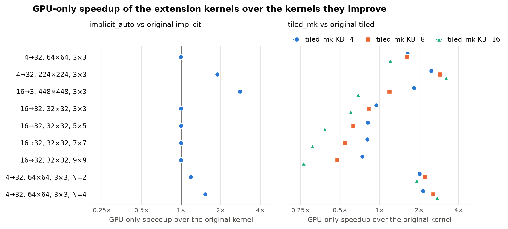
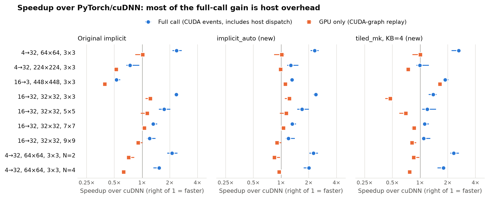

# Extension Experiments: Findings

Source material for writing up the follow-up work. All numbers come from the JSON files in this
folder; scripts are in [extensions/](../../extensions/README.md). The published study, its
seven variants, and the evidence in `results/` are unchanged.

## Summary

1. **Two new kernels improve the GPU execution time of the kernels they extend.** Over 12
   fresh processes, `implicit_auto` is 1.88× faster than `implicit` at 224×224, 2.80× faster on
   the 16→3 layer, and 1.18–1.52× faster on batched inputs. On small inputs it falls back to
   the original kernel, so it is never slower. `tiled_mk` is up to 3.20× faster than `tiled`
   on large or batched inputs but slower on 32×32 inputs.
2. **Most of the earlier speedup over cuDNN was host overhead, not GPU work.** The published
   timing places CUDA events around one synchronous call, so the CPU-side cost of the call is
   inside the interval. PyTorch's cuDNN path spends about 0.025 ms on the CPU per call and
   launches two kernels; our binding spends about 0.008 ms and launches one. With CUDA-graph
   replay, which removes host work, cuDNN matches or beats our kernels on most workloads.
3. **One real GPU-side win over cuDNN is supported:** `tiled_mk` with KB=4 on the 16→3 layer,
   1.64× faster (12/12 processes) on the synthetic workload and 1.44× on real PyNET inputs.
   `implicit_auto` is 1.11× faster on the same layer, and `implicit` and `implicit_auto` are
   1.23× faster at 16→32, 32×32, 3×3, where cuDNN pays for a separate bias kernel.
4. **On the public Zurich RAW-to-RGB test set (200 images), every replacement gives bitwise
   identical output to cuDNN.** Image quality is therefore unchanged, and whole-network latency
   shows no measurable difference.

## Setup

| | Published study | Extension experiments |
|---|---|---|
| GPU | RTX 3060 (28 SMs, sm_86) | RTX 5070 Ti (70 SMs, sm_120) |
| Software | PyTorch 2.9.1+cu129, CUDA 12.9 | PyTorch 2.11.0+cu130, CUDA 13.0, cuDNN 9.19 |
| Precision | FP32, TF32 off | FP32, TF32 off, matmul precision "highest" |
| cuDNN | autotuning on (timing), deterministic (quality) | same |
| Host | `torch.inference_mode()` | same |

The GPU differs, so these numbers must not be placed in the published tables. Comparisons
below are always between methods measured on the same GPU in the same process.

## How the timing works

### The published protocol

`evaluation.measure` (single session) and `benchmark.repeated_timing` (fresh processes) time
each call the same way:

```python
torch.cuda.synchronize()          # GPU idle, all previous work finished
start.record()                    # start event enqueued now
fn()                              # host: Python → dispatch → allocate → launch kernel(s)
end.record()
end.synchronize()                 # wait for the GPU
elapsed = start.elapsed_time(end)
```

Methods run in a seeded random order after warm-up, and the median is reported.

Because the GPU is idle and the start event is recorded before `fn()` begins, the interval
contains everything the CPU does before the first kernel starts:

```
CPU:  record(start) ─ Python + dispatch + checks + allocation ─ launch ─ (2nd launch) ─ record(end)
GPU:  [start] ··········· idle, waiting for the CPU ··········· [kernel] ·· [bias kernel] [end]
      └──────────────────────────── CUDA-event interval ─────────────────────────────┘
```

HOWTO §6 notes this ("event intervals can contain GPU idle gaps between host dispatches"),
and the report frames its results as invocation-path comparisons. The published ten-call
sensitivity test already pointed the same way: at 32×32 (C=4), `implicit` went from 1.616×
(single call) to 1.337× (ten calls per interval). The other custom variants went from about
1.2× to about 0.95×, which means their single-call advantage was host latency.

### The added GPU-only metric

`extensions/common.py:graph_time` captures 20 calls in a CUDA graph and replays them. The GPU
then runs the recorded kernels back to back with no host work, so the time measured is GPU
execution time. Every result below reports both metrics.

### What the host overhead is

From `audit.json`, at 1×4×64×64, K=32, 3×3:

| Path | Full call (event) | GPU only (graph) | Approx. host share | Kernels per call |
|---|---|---|---|---|
| PyTorch `F.conv2d` (cuDNN) | 0.0303 ms | 0.0055 ms | ≈ 0.025 ms | 2 (`implicit_convolve_sgemm<float, float, …>` + elementwise bias add) |
| Our `implicit` | 0.0145 ms | 0.0067 ms | ≈ 0.008 ms | 1 (bias fused) |

The cuDNN path dispatches through ATen's convolution logic and cuDNN plan lookup, then launches
a separate bias kernel. Our binding validates its arguments, allocates the output, and launches
one kernel. This is a property of the binding design and applies to all seven published
variants, not just the new kernels. In a full network the CPU queues work ahead of the GPU, so
this overhead mostly overlaps with execution, which is consistent with the absence of a network
speedup.

## The two kernels

| Kernel | Change | Why |
|---|---|---|
| `tiled_mk` ([tiled_mk.cu](../../extensions/tiled_mk.cu)) | Each thread computes KB output channels from one staged input tile (KB ∈ {1, 4, 8, 16}). | `tiled` reloads the same input tile once per output channel and does only R×S multiply-adds between two barriers. |
| `implicit_reg` / `implicit_auto` ([implicit_reg.cu](../../extensions/implicit_reg.cu)) | TM×TN register tile per thread; block height chosen from K; (c, r, s) and column decoding done once per block in shared-memory tables; auto mode falls back to the original kernel when the new tiles would launch fewer blocks than there are SMs. | `implicit` computes one output per thread, idles 13 of 16 thread rows when K=3, and does integer division on every load. |

## Correctness

| Check | tiled_mk | implicit_reg |
|---|---|---|
| Against float64 PyTorch (`single_session.json`) | 85/85 pass | 22/22 pass |
| Bitwise equal to the original kernel | 84/84 comparable outputs | 21/21 comparable outputs |
| Real PyNET layer inputs, 50 images × 2 layers (`real_data.json`) | 100/100 within tolerance | 100/100 within tolerance |
| Whole PyNET, 200 test images, vs the cuDNN network | 200/200, max difference 0 | 200/200, max difference 0 |

The shapes cover strides 1–2, padding 0–2, non-square filters, K = 1, 3, 5, 20, 32, and 64,
batches, all tile sizes, and a non-default stream. Both kernels keep the original summation
order and add the bias after summation. On this GPU, cuDNN's chosen kernel sums in the same
order and adds the bias in a separate kernel, which is why the outputs match bit for bit. The
published `naive` kernel, which starts from the bias, differs by about 2×10⁻⁶ in the same test,
so the test can detect differences.

## Results

All values in this section are medians of 12 paired fresh-process ratios (`repeatability/summary.json`).
"✔" means faster after Holm correction with a 95% interval above 1; "✘" means slower by the
same criterion; no mark means not supported either way.

### A. Improvement over the original kernels (GPU only)



| Workload | implicit_auto / implicit | tiled_mk KB=4 / tiled | KB=8 | KB=16 |
|---|---|---|---|---|
| 4→32, 64×64 | 1.00× | 1.63× ✔ | 1.60× ✔ | 1.20× ✔ |
| 4→32, 224×224 | **1.88× ✔** | 2.47× ✔ | 2.89× ✔ | **3.20× ✔** |
| 16→3, 448×448 | **2.80× ✔** | **1.83× ✔** | 1.19× ✔ | 0.69× ✘ |
| 16→32, 32×32, 3×3 | 1.00× | 0.94× ✘ | 0.82× ✘ | 0.60× ✘ |
| 16→32, 32×32, 5×5 | 1.00× | 0.81× ✘ | 0.63× ✘ | 0.38× ✘ |
| 16→32, 32×32, 7×7 | 1.00× | 0.81× ✘ | 0.54× ✘ | 0.31× ✘ |
| 16→32, 32×32, 9×9 | 1.00× | 0.74× ✘ | 0.48× ✘ | 0.26× ✘ |
| 4→32, 64×64, N=2 | 1.18× ✔ | 2.01× ✔ | **2.22× ✔** | 1.92× ✔ |
| 4→32, 64×64, N=4 | 1.52× ✔ | 2.14× ✔ | 2.55× ✔ | **2.74× ✔** |

`implicit_auto` reports 1.00× where it falls back to the original kernel. `tiled_mk` is slower
on 32×32 inputs because a 32×32 output has only four 16×16 spatial blocks. Grouping K=32 filters
into KB-sized groups leaves 128/KB blocks (32, 16, and 8 for KB = 4, 8, 16) on a 70-SM GPU, so
most SMs idle; the loss grows with KB and with filter size. Choosing KB from the block count, as
`implicit_auto` does, would avoid this; it is not implemented.

### B. Speedup over cuDNN: full call vs GPU only



| Workload | cuDNN GPU ms | implicit (orig) event / **graph** | implicit_auto event / **graph** | tiled_mk KB=4 event / **graph** |
|---|---|---|---|---|
| 4→32, 64×64 | 0.0068 | 2.37× ✔ / **1.02×** | 2.32× ✔ / **1.02×** | 2.63× ✔ / **1.00×** |
| 4→32, 224×224 | 0.0268 | 0.74× ✘ / **0.52× ✘** | 1.28× ✔ / **0.99×** | 1.00× / **0.74× ✘** |
| 16→3, 448×448 | 0.1157 | 0.53× ✘ / **0.39× ✘** | 1.31× ✔ / **1.11× ✔** | 1.87× ✔ / **1.64× ✔** |
| 16→32, 32×32, 3×3 | 0.0092 | 2.35× ✔ / **1.23× ✔** | 2.39× ✔ / **1.23× ✔** | 1.39× ✔ / **0.47× ✘** |
| 16→32, 32×32, 5×5 | 0.0202 | 1.74× ✔ / **1.14×** | 1.69× ✔ / **1.14×** | 1.20× / **0.70× ✘** |
| 16→32, 32×32, 7×7 | 0.0344 | 1.32× ✔ / **1.06×** | 1.32× ✔ / **1.06×** | 1.12× ✔ / **0.86×** |
| 16→32, 32×32, 9×9 | 0.0476 | 1.21× ✔ / **0.91×** | 1.20× ✔ / **0.90×** | 1.10× / **0.82×** |
| 4→32, 64×64, N=2 | 0.0076 | 2.11× ✔ / **0.71×** | 2.24× ✔ / **0.84×** | 2.31× ✔ / **0.85×** |
| 4→32, 64×64, N=4 | 0.0116 | 1.53× ✔ / **0.63× ✘** | 2.01× ✔ / **0.95×** | 1.79× ✔ / **0.77× ✘** |

The cuDNN identical-callable control is 0.99–1.03× (event) and 1.00× (graph) on every
workload. Other GPU-only results from the same run: the original `tiled` is 1.11× ✔ faster
than cuDNN at 32×32, 9×9; `tiled_mk` KB=8 is 1.06× ✔ on the 16→3 layer; KB=16 is 0.96× at
224×224 and 0.99× at N=4.

### C. Real data: Zurich RAW-to-RGB test set with pretrained PyNET

Layer inputs captured from 50 test images; 20 different real inputs per timed graph
(`real_data.json`, one process).

| Layer (real input) | Method | Full call vs cuDNN | GPU only vs cuDNN |
|---|---|---|---|
| 4→32, 1×4×226×226 | implicit (orig) | 0.85× | 0.53× |
| | implicit_auto | 1.45× | 0.99× |
| | tiled_mk KB=16 | 1.41× | 0.95× |
| 16→3, 1×16×450×450 | implicit (orig) | 0.49× | 0.36× |
| | implicit_auto | 1.22× | 1.02× |
| | **tiled_mk KB=4** | **1.72×** | **1.44×** |

Whole network, 200 test pairs (448×448 RAW → sRGB), both layers replaced:

| Method | PSNR (dB) | SSIM | ΔE2000 | Max diff vs cuDNN | Network event ms | Network graph ms |
|---|---|---|---|---|---|---|
| cuDNN | 20.8432 | 0.7176 | 7.5272 | 0 | 63.82 | 59.79 |
| implicit | 20.8432 | 0.7176 | 7.5272 | 0 | 63.95 | 59.49 |
| implicit_auto | 20.8432 | 0.7176 | 7.5272 | 0 | 63.67 | 59.71 |
| tiled_mk | 20.8432 | 0.7176 | 7.5272 | 0 | 63.69 | 59.55 |

The two layers' GPU savings total at most about 0.03 ms (the 16→3 layer with `tiled_mk`; the
4→32 layer saves nothing) against a 60 ms network, so network
differences of a few tenths of a millisecond are run-to-run noise (one process, no
statistics). PSNR differs from the published 21.1754 because this uses the first 200 test
pairs, not all 1,204.

## What the evidence supports

**Supported:**
- `implicit_auto` reduces GPU execution time relative to `implicit` by 1.18–2.80× on the four
  workloads where it uses register tiles, and never increases it (1.00× where it falls back).
- `tiled_mk` reduces GPU execution time relative to `tiled` by up to 3.20× on large and batched
  inputs, and increases it on 32×32 inputs (block starvation).
- On this GPU, `tiled_mk` (KB=4) executes the 16→3 PyNET layer 1.64× faster than cuDNN (12/12
  processes), and 1.44× faster on real PyNET activations.
- Single synchronous calls through our binding have lower latency than `F.conv2d` with bias,
  because of lighter host dispatch and a fused bias (one kernel instead of two).
- The replacements produce bitwise identical PyNET output on 200 public test images.

**Not supported:**
- That our kernels generally compute faster than cuDNN. On the GPU alone, cuDNN is equal or
  faster on most workloads.
- Any whole-network PyNET speedup.
- Any statement about the RTX 3060 numbers in the published tables. These results come from a
  different GPU and software stack.

## Limitations

- **One GPU, unlocked clocks.** Small-input full-call times vary with CPU and GPU clock state
  (cuDNN 64×64 full-call medians ranged from 0.016 to 0.098 ms across sessions); GPU-only
  medians are far more stable.
- **cuDNN autotuning.** The autotuner can choose a different algorithm in different processes;
  the paired 12-process design absorbs this, but single-process audit numbers can differ.
- **Graph replay is a lower bound on per-call cost.** It reflects how a captured or pipelined
  network would run; eager single calls pay host overhead for every method.
- **Fixed design choices.** The `implicit_auto` threshold (blocks ≥ SM count) and the `tiled_mk`
  KB values were chosen during development on this GPU. The KB used for the real layers (4 for
  K ≤ 4, otherwise 16) was fixed before the real-data run.

## Files

| File | Contents |
|---|---|
| `single_session.json` | Correctness counts; one-session event timings for all variants (200 reps) |
| `audit.json` | Settings in force, cuDNN kernel names, per-method event/graph/kernel times |
| `repeatability/run_00.json` … `run_11.json` | Per-process event and graph medians |
| `repeatability/summary.json` | Paired statistics, both metrics, vs cuDNN and vs originals |
| `real_data.json` | Real-activation layer results and whole-network quality/latency |
| `ext_vs_cudnn.png`, `ext_vs_original.png` | Figures above |
